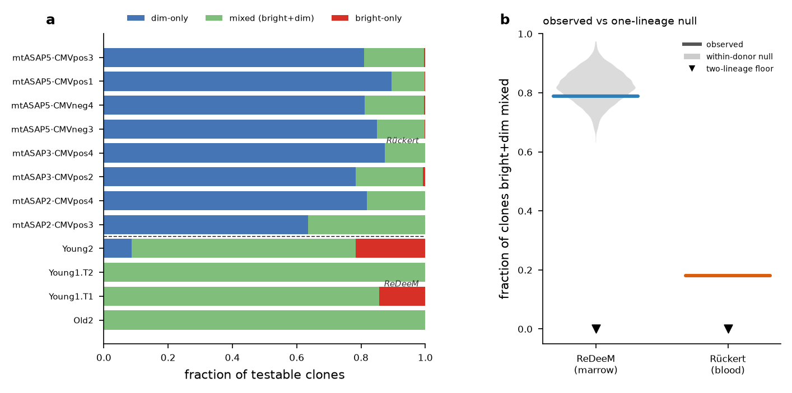

# Developmental origins of NK cells: TCR footprints and mtDNA lineage tracing

[](https://github.com/Eomesodermin/Thymic_NK_development/actions/workflows/ci.yml)
[](LICENSE)

**Do NK cells carry a TCR-rearrangement footprint of a thymic or aborted-T origin, and are
CD56^bright and CD56^dim NK cells developmentally distinct?**

This project tests that question across public single-cell datasets with two independent kinds of
evidence: relic TCR rearrangements read from single-cell VDJ data, and somatic mitochondrial-DNA
mutations used as a natural lineage barcode. The full write-up, with every analysis, result and
limit, is in **[`report.md`](report.md)**.

## Hypothesis

A subset of NK cells, enriched in CD56^bright, might arise through a thymic or aborted-T pathway
and carry a molecular relic of it as non-productive TCR rearrangements. If so, bright and dim NK
cells would also be developmentally distinct lineages.

## Main finding

> The original hypothesis was **not confirmed**, and the project's main contribution is an account
> of why the available assays and data cannot yet settle it. The TCR-footprint approach is defeated
> by measurement biology: non-productive rearrangements are targets of nonsense-mediated decay, so
> mRNA-based VDJ data sees a deflated floor, not the true rate. The mtDNA alternative is defeated by
> data scarcity: no thymic dataset exists, and the tumour cohorts are thin. The clearest result is
> that **CD56^bright and CD56^dim NK cells are not cleanly two lineages**, replicated across blood
> and marrow, two assays and two labelling methods.

| Question | Verdict | Confidence |
|----------|---------|:----------:|
| Do NK cells carry non-productive TCR rearrangements above background? | Marginally, at about 0.4–0.5%, roughly 3–18× below αβ and γδ T cells | moderate |
| Is the footprint enriched in CD56^bright NK? | No detectable enrichment (OR ≈ 0.7–1.2, all p > 0.45) | moderate |
| Do NK cells follow a thymic (DN-branch) trajectory? | Reproducible in direction but not significant (permutation p = 0.29) | low |
| **Are CD56^bright and CD56^dim NK two lineages?** | **No clear evidence of two**; clean segregation is excluded, but this rests on about 38 informative clones in marrow | moderate (strongest result) |
| Are tumour-infiltrating NK cells clonally restricted? | Apparent in high-grade serous ovarian cancer only (not lung), in about 2 patients | low to moderate |
| Are NK cells clonally closer to T cells or myeloid cells? | Myeloid-leaning (5 of 6 patients, p ≈ 0.06); human evidence mixed | low to moderate |



**(a)** Per donor, the fraction of testable clones that are dim-only, mixed or bright-only, in sorted
blood NK (Rückert) and bone-marrow NK (ReDeeM). **(b)** The observed fraction of mixed clones
against a within-donor permutation null; a two-lineage model would put it near zero.

## Approach

1. **Stream A, TCR footprint.** Count non-productive and partial TCR rearrangements per NK cell from
   re-aligned single-cell VDJ data (Suo developing-immune atlas, Domínguez Conde cross-tissue atlas),
   compare CD56^bright with CD56^dim, and reproduce the published Dandelion NK-from-DN trajectory with
   a permutation null and a transcriptome-only control. A cycloheximide NMD-block dataset is the
   assay control.
2. **Pivot to Stream B, somatic mtDNA lineage tracing.** Infer clones from shared sub-homoplasmic
   mtDNA variants within donors, and test (B1) whether bright and dim NK share clones more than a
   single-lineage null allows, and (B2) whether tumour-infiltrating NK are clonally restricted.
3. **Power gates throughout.** Every mtDNA test is preceded by a count of how many cells carry an
   informative variant, and results are labelled power-limited where the answer is no.

The clone-calling code is a tested, reusable package, [`scripts/mtclone/`](scripts/mtclone/), that
turns a cell-by-variant matrix into clones and sharing statistics against permutation nulls.

## Data

All datasets are public. Accessions, papers and the role of each are tabulated in
[`report.md` §5](report.md#5-datasets-provenance-and-characteristics). Nothing heavy is stored in
this repository.

| Dataset | Accession | Used for |
|---------|-----------|----------|
| Suo et al. 2022, developing immune atlas | E-MTAB-11343, E-MTAB-11388 | TCR footprint, Dandelion trajectory |
| Domínguez Conde et al. 2022, cross-tissue atlas | E-MTAB-11536 | Bright-versus-dim TCR footprint |
| Suo, Tuong et al. 2023, cycloheximide NMD block | E-MTAB-12524 | Assay control |
| Rückert et al., sorted blood NK (ASAP-seq) | GSE197008, GSE197037 | Analysis B1 |
| Weng et al. 2024, ReDeeM bone marrow | GSE219014 | Analysis B1 |
| Liu et al. 2026, tumour mtscATAC-seq | GSE302113 | Analysis B2 |
| Six et al. 2020, gene-therapy integration sites | SRP139090 | Clonal-origin cross-check |

## Assumptions and limits

- Somatic mtDNA variants are treated as clonal barcodes. Clone calls depend on coverage and on QC
  thresholds, which is why each analysis includes a robustness sweep and a doublet floor.
- The bright-versus-dim result rests on few informative clones (38 in the marrow arm), so a
  small true effect could be missed. The report states what power each test had.
- No thymic mtDNA lineage-tracing dataset exists. A GEO sweep (155 series, 28 search terms) found
  none, so the thymic-origin question cannot be tested directly by this method yet.
- Tumour clonal restriction is shown in two ovarian patients and is a hypothesis, not an
  established result.
- Section 10 of the report sets out what data would settle each open question.

## Reproducing

```bash
conda env create -f environment.yml && conda activate mtclone   # or: pip install -e ".[dev]"
export NK_DATA_DIR=/path/to/data      # raw/ and processed/ live here, outside the repository
pytest                                # unit tests for the mtclone package
```

Each analysis directory has its own README with the run order:
[`nk_bright_dim_lineage`](scripts/nk_bright_dim_lineage/README.md),
[`tumor_nk_clonal_restriction`](scripts/tumor_nk_clonal_restriction/README.md) and
[`dandelion_reproduction`](scripts/dandelion_reproduction/README.md). The TCR-footprint quantification
is in [`scripts/tcr_footprint/`](scripts/tcr_footprint/). Re-aligning the VDJ libraries needs
`cellranger vdj` and a cluster, as described in report §12.

## Repository layout

```
report.md             the full project report (start here)
report_assets/        figures used in the report
docs/                 literature review and two supporting memos
scripts/mtclone/      mtDNA clone-calling package, with tests
scripts/nk_bright_dim_lineage/         Analysis B1: bright versus dim lineage
scripts/tumor_nk_clonal_restriction/   Analysis B2: tumour NK clonal restriction
scripts/dandelion_reproduction/        Dandelion NK-from-DN trajectory reproduction
scripts/tcr_footprint/                 bright-versus-dim TCR footprint quantification
results/              per-analysis result memos and tables
```

## Citation

See [`CITATION.cff`](CITATION.cff). Released under the [MIT License](LICENSE).
